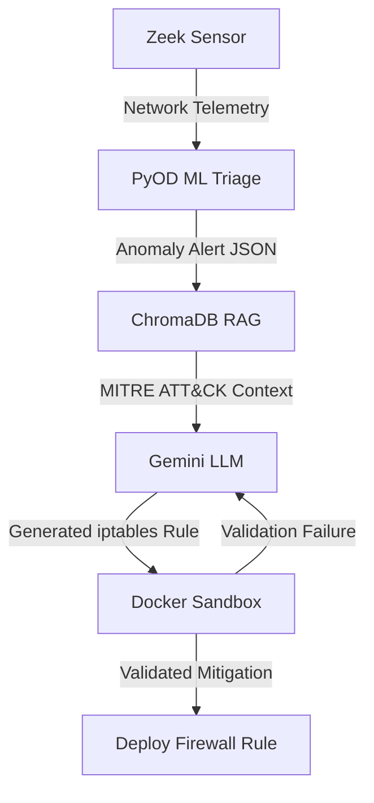

# HRT-Agent SOC Pipeline

An autonomous Level-1 SOC Analyst pipeline that detects network anomalies using machine learning, retrieves relevant mitigation context via a RAG architecture, and synthesizes/validates firewall rules deterministically using an isolated sandbox.

## 3-Tier Architecture

## Features

1. **Telemetry & Detection:** Zeek processes network traffic, generating high-fidelity `conn.log` telemetry. The PyOD Isolation Forest anomaly detection engine actively monitors these logs and fires alerts when malicious activity is discovered.
2. **Contextual Retrieval:** The RAG engine retrieves relevant MITRE ATT&CK mitigation techniques from a local ChromaDB vector database.
3. **LLM Synthesis:** Google Gemini acts as an autonomous Level-1 SOC Analyst, correlating the anomaly alert with the MITRE context to generate JSON-formatted mitigation strategies.
4. **Deterministic Sandboxing:** Before an `iptables` rule is deployed, the agent spins up an ephemeral Alpine Linux container to syntax-check and validate the rule. If the rule fails, the agent self-corrects using the resulting standard error.

## Orchestration

The pipeline is integrated via `hrt_orchestrator.py` which continuously watches for generated anomaly alerts and automatically spawns the RAG synthesis process. Benchmark the end-to-end flow using `run_benchmark.py`.
