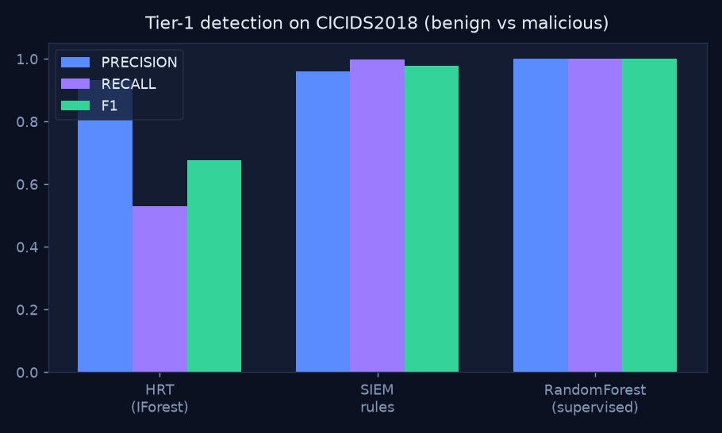
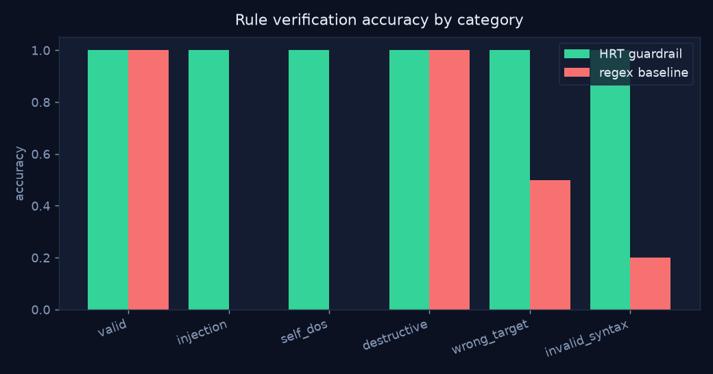
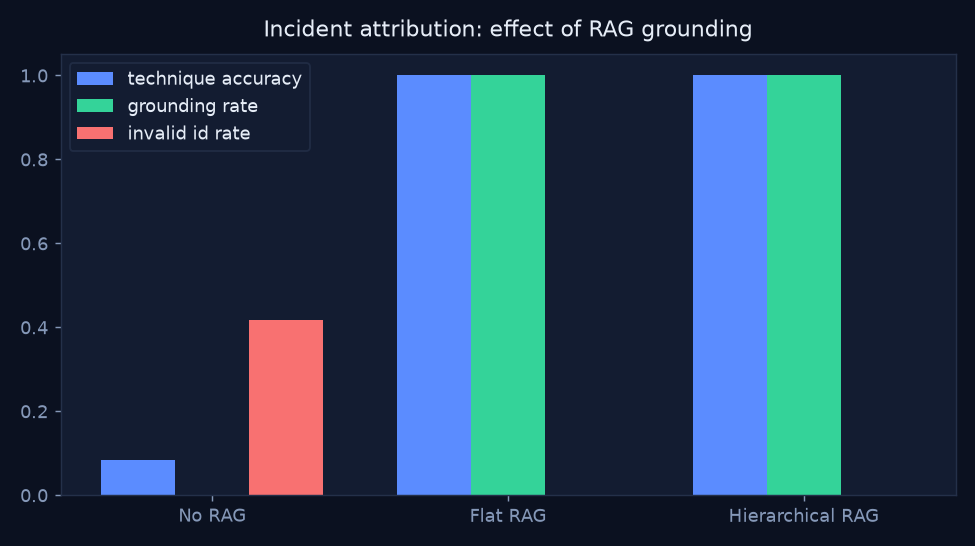
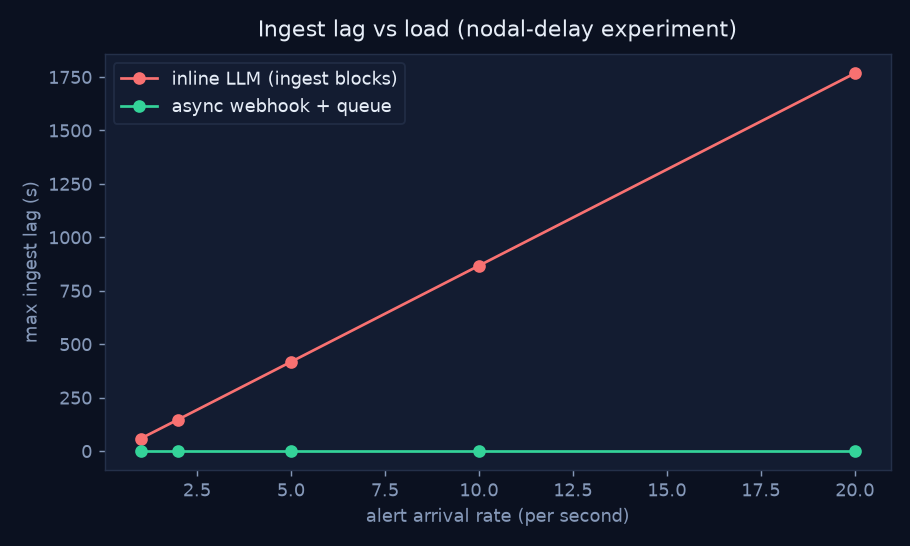
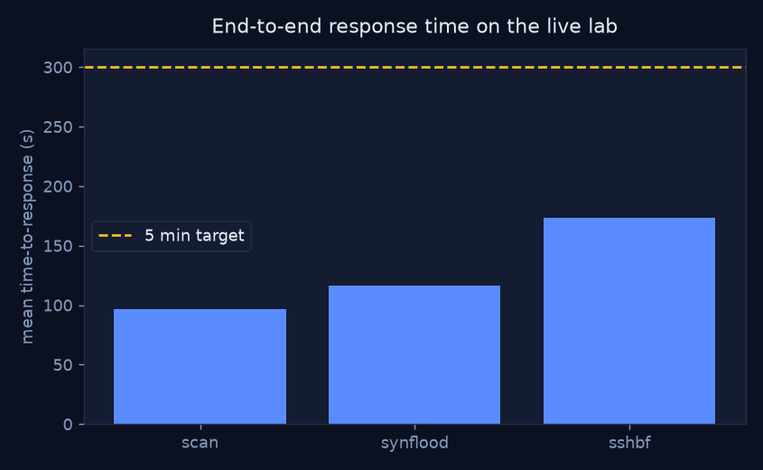

# HRT-Agent - Evaluation Results

Generated by `hrt report` from the JSON in this directory. All numbers are measured on this machine (CPU-only, local Llama via Ollama).

## 1. Tier-1 detection (CICIDS2018)

Stratified sample: 34,105 flows, 5 classes.

| Detector | Precision | Recall | F1 | ROC-AUC |
|---|---|---|---|---|
| HRT_iforest | 0.9333 | 0.53 | 0.6761 | 0.9629 |
| SIEM_rules | 0.9588 | 0.9977 | 0.9779 | 0.9715 |
| RandomForest_supervised | 1.0 | 0.9998 | 0.9999 | 1.0 |

## 1b. Telemetry reduction (measured on the lab capture)

634,464 Zeek records (241,902,291 B, 381.3 B/record) produced 10 alerts.

| Alert rules | Flows summarised | Raw bytes | Alert JSON bytes | Reduction |
|---|---|---|---|---|
| PORT_SCAN | 1,024 | 390,420 | 706 | 99.82% |
| PORT_SCAN | 1,024 | 390,420 | 706 | 99.82% |
| PORT_SCAN | 1,024 | 390,420 | 706 | 99.82% |
| PORT_SCAN | 1,024 | 390,420 | 708 | 99.82% |
| SYN_FLOOD, CONN_FLOOD | 77,827 | 29,673,125 | 704 | 100.00% |
| SYN_FLOOD, CONN_FLOOD | 98,670 | 37,619,942 | 706 | 100.00% |
| SYN_FLOOD, CONN_FLOOD | 19,311 | 7,362,711 | 704 | 99.99% |
| BRUTE_FORCE | 25 | 9,531 | 689 | 92.77% |
| BRUTE_FORCE | 25 | 9,531 | 687 | 92.79% |
| BRUTE_FORCE | 25 | 9,531 | 690 | 92.76% |

Median per-alert reduction **99.82%**; everything Zeek logged (benign included) vs everything forwarded to the LLM: **99.997%** smaller.

## 2. Tier-3 rule verification

28 adversarial cases. **HRT guardrail accuracy: 100%**, **regex baseline: 39%**.

The regex baseline dangerously accepted 17 unsafe rules: `inject_semicolon, inject_pipe, inject_backtick, inject_subshell, inject_amp, block_internal_lan, block_server, block_gateway, block_known_good_client, block_all, block_broad_prefix, block_loopback, wrong_ip, bad_octet, bad_flag, negation, bad_port_range`.

## 3. Incident attribution & RAG ablation

LLM: `ollama:llama3.2:3b`, 12 synthesised incidents.

| Mode | Technique acc. | Tactic acc. | Grounding | Invalid-ID | Rule-valid | Escalation |
|---|---|---|---|---|---|---|
| no_rag | 0.0833 | 0.0 | 0.0 | 0.4167 | 0.9167 | 0.0833 |
| rag_flat | 1.0 | 1.0 | 1.0 | 0.0 | 1.0 | 0.0 |
| rag_hier | 1.0 | 1.0 | 1.0 | 0.0 | 1.0 | 0.0 |

Median analysis latency (s): rag_hier 93.61, rag_flat 56.05, no_rag 52.29.

Hierarchical retrieval: recall@1 1.0, recall@3 1.0, recall@5 1.0; the tactic prefilter shrinks the search space by 92.8% on average.

Scoring: a technique counts as correct when it (or its parent technique) is in the accepted set for the true CICIDS label (`eval/labels.py`); tactics are compared after case/space normalisation. Invalid-ID = the cited ID is not in the local ATT&CK catalogue.

What the no-RAG model actually answered, attempt by attempt, is in [`agent_probe_norag.txt`](agent_probe_norag.txt).

## 4. Async orchestration (nodal delay)

Inference 3.0s/incident, 2 async workers.

| Rate (/s) | Inline max ingest lag | Async max ingest lag | Inline overloaded |
|---|---|---|---|
| 1 | 58.0s | 0.0s | True |
| 2 | 147.5s | 0.0s | True |
| 5 | 417.2s | 0.0s | True |
| 10 | 867.1s | 0.0s | True |
| 20 | 1767.05s | 0.0s | True |

## 5. End-to-end response time (live lab)

| Attack | Runs | Mean (s) | Min | Max | < 5 min |
|---|---|---|---|---|---|
| scan | 3 | 96.82 | 86.13 | 102.72 | yes |
| synflood | 3 | 116.54 | 108.43 | 121.47 | yes |
| sshbf | 3 | 173.35 | 139.29 | 195.51 | yes |

